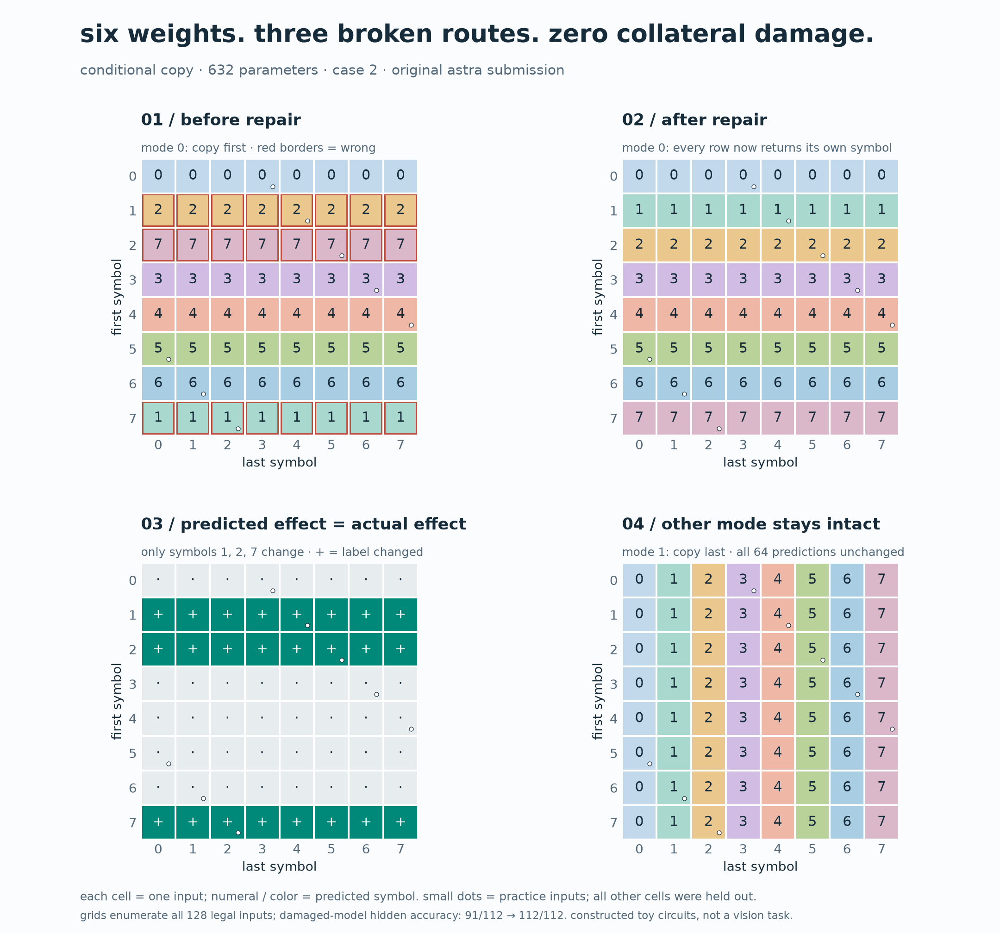
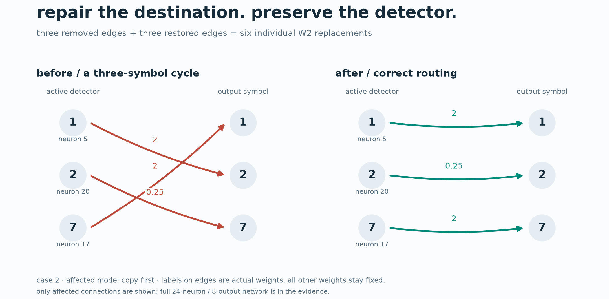
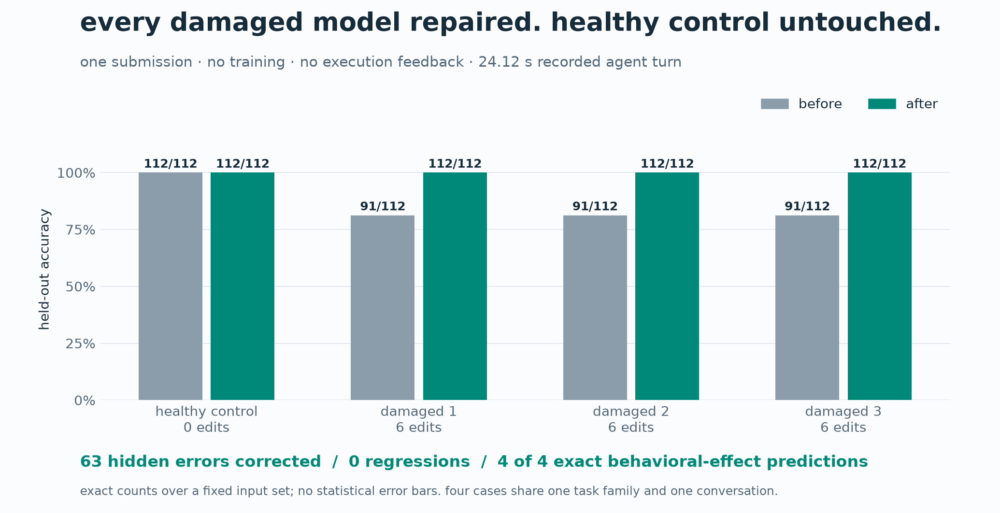

# toy weight repair

a small, reproducible test of whether an agent can inspect neural-network weights, diagnose
a planted defect, predict its behavioral effects, and repair it without training.

**result:** in one tool-free submission, gpt-6-astra repaired three 632-parameter networks
from **81.25% to 100%** held-out accuracy, made exact prospective behavioral predictions,
and left a healthy control unchanged. the recorded agent turn took **24.12 seconds**.



**what changed?** three symbol routes were wrong. astra changed six output weights and
correctly predicted every affected input. the other switch mode retained all 64 predictions.
white dots mark practice examples; other cells were excluded from the editor prompt.
these are exhaustive symbol-task predictions, not image-recognition results.



| case | hidden accuracy before | after | changed parameters | effect prediction |
|---|---:|---:|---:|---|
| healthy control | 112/112 | 112/112 | 0 | exact |
| damaged 1 | 91/112 | 112/112 | 6 | exact |
| damaged 2 | 91/112 | 112/112 | 6 | exact |
| damaged 3 | 91/112 | 112/112 | 6 | exact |



read the **[technical report](REPORT.md)** for the construction, causal checks, and limits.
the circuits are hand-constructed: this is a toy demonstration, not evidence of general
autointerpretability or improvement of a pretrained math model.

## reproduce the published result offline

requires python 3.12 and [uv](https://docs.astral.sh/uv/). numpy is the only runtime dependency.
no API key, model download, GPU, or live agent call is needed for verification.

```sh
git clone https://github.com/Occupying-Mars/toy-weight-repair.git
cd toy-weight-repair
uv sync --locked
uv run python -m toy_weight_repair.verify
uv run pytest -q
```

verification checks publication hashes, regenerates the exact fixtures and prompt, confirms
the answer matches the event record, and replays the scorer in a temporary directory. it
does not modify the published evidence. hashes establish consistency, not independent
attestation of the model service or the time when records were produced.

## reproduce the figures

```sh
uv sync --locked --group plots
uv run --group plots python scripts/make_figures.py
```

the script computes predictions from the original weights and recorded edits. it exports
all three figures as PNG, SVG, and PDF. [downloadable figures and captions](figures/README.md).
matplotlib is an optional dependency; offline score verification still needs only numpy.

## run another live attempt

this requires an authenticated codex CLI that supports `gpt-6-astra`, the documented CLI
flags, and the configured feature names. the original CLI was 0.163 alpha; other versions
may require launcher adjustments. agent access may consume your account's usage allowance.

```sh
uv run toy-repair prepare --name fresh-001
uv run toy-repair run --name fresh-001
```

if codex is not on your path, set `WSP_CODEX_BIN` to its executable. generation and scoring
run locally; the live editor is a remote model. the launcher requests no tools and rejects
recorded unexpected tool use. this is a protocol restriction, not an independent security
boundary. `fresh-001` regenerates the published fixtures: it is a repeat attempt, not a new
hidden benchmark. change seeds in the generator for independent fixtures and document it.

## repository contents

- `src/toy_weight_repair/`: standalone generator, scorer, agent launcher, and verifier
- `tests/`: nine targeted fixture/scorer checks
- `evidence/toy-symbol-repair-001/`: original inputs, prompt, answer, truth, results, and logs
- `provenance/`: original experiment source and publication hash/transformation manifest
- `figures/` and `scripts/make_figures.py`: shareable figures and evidence-driven rendering
- `.github/workflows/`: offline verification and test automation

the public package is extracted from a larger local experiment workspace. original source
is preserved for the recorded source hash; it is an archival snapshot, not the standalone
entry point. conversation identifiers and local launcher paths are excluded from publication;
the scientific inputs, original answer, and results are unchanged. details are in
[the publication manifest](provenance/publication-manifest.json).

inspired by [weight-space programming](https://rikiyat.github.io/blog/weight-space-programming/)
and its [released experiments](https://github.com/RikiyaT/lm_understand-logs). this repository
contains our constructed toy task and is not an official reproduction of that work.

license: [MIT](LICENSE).
