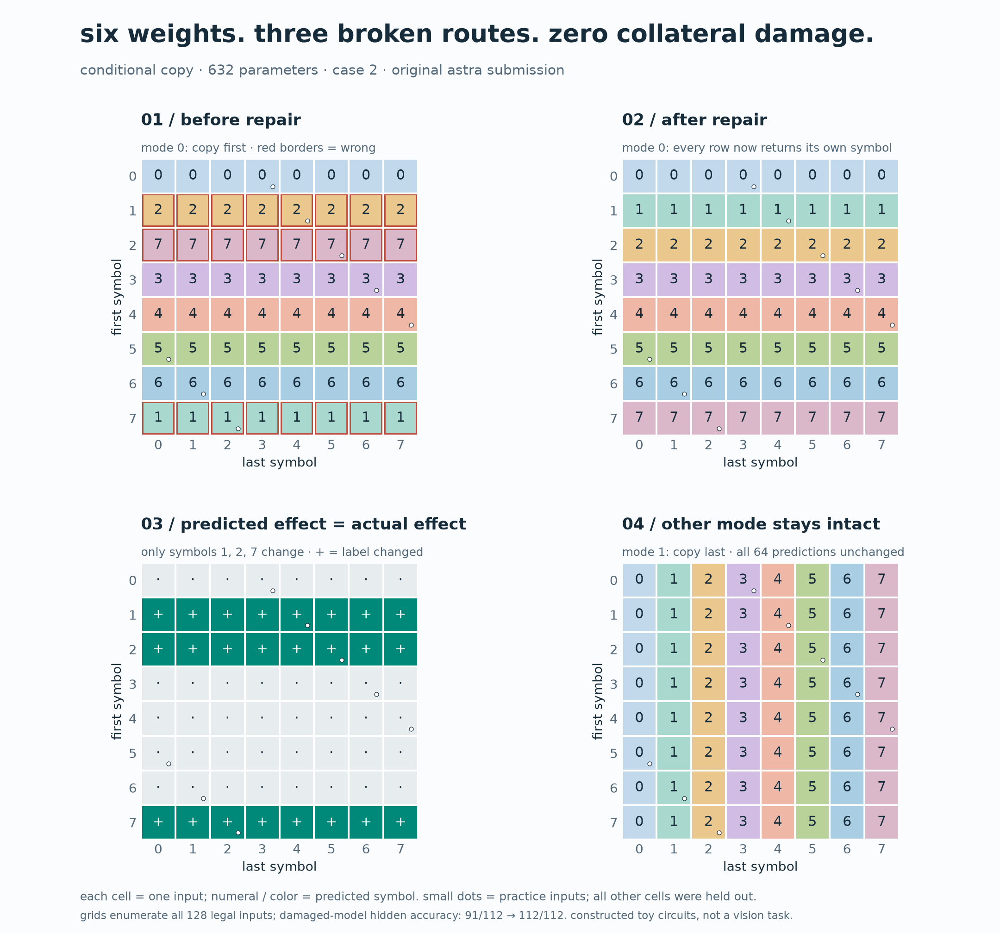
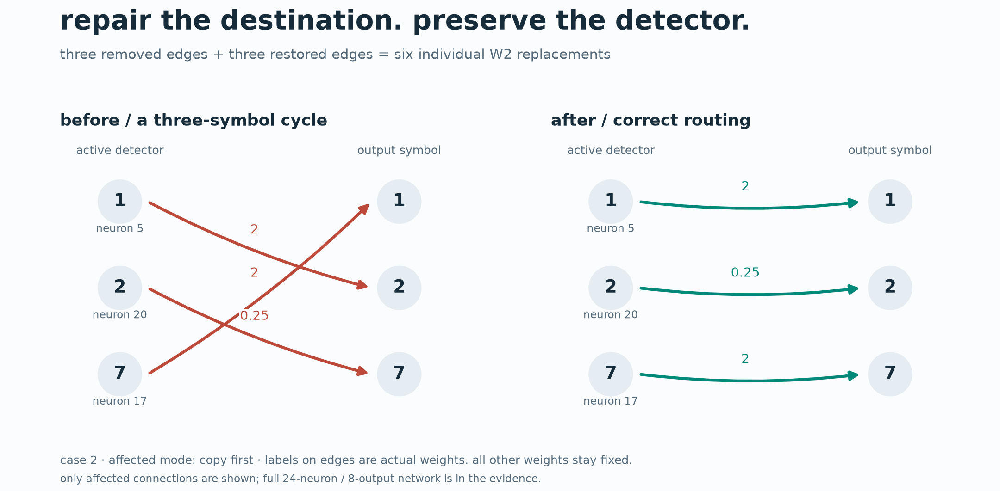
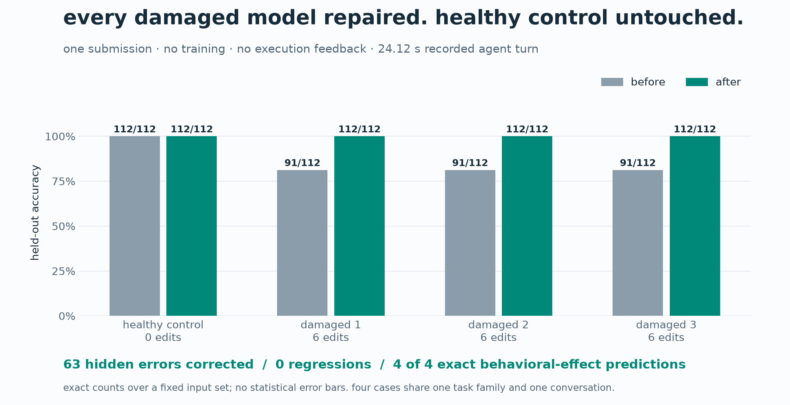

# direct weight repair with prospective behavioral predictions in a tiny conditional-copy network

technical report · 3 november 2026

## abstract

we test a minimal version of weight-space improvement: an agent inspects a fixed network,
identifies a behavioral defect, directly edits parameters without training, and predicts
the intervention's effects before evaluation. four 632-parameter relu networks implement
conditional copying of one of two input symbols. three contain planted output-routing
defects; one is a healthy control. neuron permutations, positive rescalings, and inactive
distractors obscure the original neuron layout. in one tool-free submission, gpt-6-astra
repaired every damaged model using six parameter replacements per model, improved each
from 91/112 to 112/112 hidden correct predictions, and preserved the healthy control.
all predicted behavioral-change slices matched exhaustive intervention checks. these results
demonstrate controlled synthetic weight repair, with important limits: the circuits are
constructed, all failure categories appear in practice, and no naturally learned language
model mechanism is recovered.



*figure 1. case 2, the first damaged fixture in the recorded order. each grid cell is one
input pair; symbols and colors encode output labels. red outlines mark initial errors.
white dots identify practice inputs. the changed-label map exactly matches astra's prediction;
the other switch mode remains unchanged. the grids enumerate 128 legal inputs across both
modes; the hidden accuracy denominator separately excludes the 16 practice inputs.*

## 1. motivation and research question

[weight-space programming](https://rikiyat.github.io/blog/weight-space-programming/)
examines whether language models can understand or construct neural computations through
their numerical parameters. its math-editing experiment motivated a longer local evaluation,
but that evaluation was not completed. this toy task preserves a narrower experimental
pattern while avoiding long autoregressive generation: fixed weights, bounded direct edits,
no gradient training, a hidden evaluation, and an explicit mechanistic hypothesis.

the question is whether an agent can diagnose and selectively repair a simple planted
circuit defect while accurately predicting the resulting behavioral changes. this is repair
of an induced defect, not improvement of a naturally imperfect pretrained model. the earlier
math screen found no gain and the full math rerun remains unfinished; the toy result does
not replace either conclusion.

## 2. task and network

let a,b belong to {0,...,7}, and let mode m belong to {0,1}. the target is a when m=0
and b when m=1. all 128 legal inputs can be enumerated. the input vector concatenates
an eight-way one-hot encoding of a, an eight-way one-hot encoding of b, and the scalar m.

the network computes:

```text
x = [one_hot(a), one_hot(b), m]       # 17 inputs
h = relu(W1 x + b1)                  # 24 hidden neurons
logits = W2 h + b2                   # 8 outputs
prediction = argmax(logits)
```

parameter count is 24×17 + 24 + 8×24 + 8 = 632. before scrambling, eight neurons compute
relu(x[a=s] − m), and eight compute relu(x[b=s] + m − 1). exactly one of these 16
detectors is active on a legal input. its output connection selects the correct symbol.
the other eight neurons have input weights between −0.1 and 0.1 and bias −3, so they
remain inactive on every legal input despite unrelated output weights.

each hidden neuron is multiplied by a positive scale from {0.5,1,2,4}, its output column
is divided by that scale, and hidden neurons are permuted. relu's positive homogeneity
preserves the clean function. these transformations remove a fixed neuron-index convention;
they do not produce a distributed representation comparable to a transformer.

## 3. defects, blinding, and evaluation split

three fixtures use seeds 901, 1229, and 447 and contain a three-symbol cyclic reassignment
of output destinations in one selected mode. the fourth, seed 317, remains correct. fixture
order is shuffled with seed 20261103. the seeds, clean counterparts, control identity, and
damage labels are withheld from the editor. full damaged-or-clean weights are supplied.

each defect changes three of 16 mode/selected-symbol slices. each slice contains eight
inputs differing only in the unselected symbol. thus 24 of 128 predictions become wrong,
giving exact exhaustive accuracy 81.25%. by chance all three damaged fixtures in this run
selected mode zero. the implementation can generate either mode, but this result covers
only the observed first-symbol-branch defects.

practice contains 16 examples per model, one for each slice. mode-zero examples use
(a,b)=(s,(s+3) mod 8); mode-one examples use ((s+5) mod 8,s). the other 112 combinations
are excluded from the editor prompt. each damaged fixture has 21 hidden errors and therefore
91/112 hidden accuracy before editing.

this split exposes every error category during practice. hidden evaluation tests consistency
across the irrelevant input symbol, not discovery of a new rule or unseen failure class.
the full truth and exact split are public for replay; future attempts on the same fixtures
must not be described as fresh hidden-benchmark evaluation.

## 4. editor protocol

one gpt-6-astra conversation, with high reasoning effort, receives all four cases. the
editor gets the task specification, architecture, numerical weights, and practice targets
and predictions. it is told that some models may already be correct. it receives no clean
weights or operator truth and has no executable tools or evaluation feedback.

the budget is one submission, at most 24 individual W2 replacement entries per model.
training, fitting, and automated parameter search are prohibited by instruction. the answer
must identify each model, explain its mechanism, propose replacements, forecast hidden
accuracy, and predict exactly which `(mode, selected symbol)` slices change output labels.
the JSON formatting example contains a sample mode-zero slice; it is a format cue rather
than a neutral counterbalanced prompt, another reason to avoid broad identification claims.

the original call used the local codex launcher, version 0.163 alpha, with shell, web,
MCP, and other action tools disabled. the receipt records no unexpected tool use. the
recorded agent turn took 24.123 seconds, with 21,949 input tokens, 1,004 output tokens,
and 358 reasoning-output tokens reported by the service. cached input tokens were 5,760;
the records do not establish the origin or contents of that service-side cache. there was
no conversation resume or explicit prior-message context supplied for this attempt.

the public repository includes a standalone extraction of the launcher and experiment.
it does not make another live call to obtain the published result. offline replay uses
the original answer and preserves its bytes.

## 5. scoring and controls

a case passes only when all 112 hidden labels are correct, no previously correct hidden
label regresses, and prospective changed-slice predictions exactly match execution over
all 128 legal inputs. a predicted slice must change on every one of its eight inputs;
partial slice changes do not satisfy an exact prediction. the healthy control must also
retain identical weights. the reported forecast of accuracy is preserved, although the
pass criterion uses observed accuracy and exact changed slices rather than a separate
forecast-calibration threshold.

the known-good networks provide positive controls and score perfectly. nine targeted tests
check clean behavior, exact error masks, parameter count, positive-control scorer acceptance,
and rejection of a repair with an incorrect prospective effect prediction. lint and format
checks cover the extracted runnable package. an independent verifier regenerates fixtures
and the prompt byte for byte, checks publication hashes, and reproduces the original scores
from the preserved answer in a temporary directory.

## 6. results

| case | condition | hidden before | hidden after | changed entries | exact changed-slice prediction |
|---|---|---:|---:|---:|---|
| 1 | healthy | 112/112 | 112/112 | 0 | yes |
| 2 | damaged | 91/112 | 112/112 | 6 | yes |
| 3 | damaged | 91/112 | 112/112 | 6 | yes |
| 4 | damaged | 91/112 | 112/112 | 6 | yes |

all four cases pass. each repair corrects all 21 hidden errors with no regression. across
the damaged models, 63 wrong hidden predictions are corrected by 18 parameter replacements.
we report exact finite-domain counts rather than treating combinations as independent
samples for a population-level significance test.

astra diagnosed these mode-zero output cycles:



*figure 2. actual output connections for the affected detectors in case 2. three nonzero
weights are removed and three correct destinations restored; edge labels show their actual
values. this is a projection of the relevant circuit, not the complete network.*

| case | wrong routing before repair | predicted changed symbols |
|---|---|---|
| 2 | 1→2, 2→7, 7→1 | 1, 2, 7 |
| 3 | 0→1, 1→5, 5→0 | 0, 1, 5 |
| 4 | 4→6, 6→7, 7→4 | 4, 6, 7 |

in each case it removed three incorrect output destinations and reinstated the correct
destinations with reciprocal activation-scale weights. the predicted affected slices
matched exhaustive behavior. the healthy model's explanation correctly identified intact
gating, reciprocal scales, and inactive distractors; its edit list was empty.



*figure 3. hidden accuracy for every fixture, including the untouched healthy control.
counts are exact over a fixed finite input set. no error bars or independent-sample
significance claim is appropriate for this four-case, single-conversation demonstration.*

## 7. interpretation and limitations

the outcome supports a concrete, bounded ability: reading a sparse relu circuit, recognizing
misrouted outputs, deriving a small exact repair, and forecasting its selective behavioral
effect. the predictions were recorded before scoring, so this goes beyond attaching an
explanation to an already observed successful edit.

several limits restrict the claim. the network is constructed rather than learned. its
inputs have explicit semantics, neurons are sparse symbol detectors, corruption is a small
output-routing change, and all affected categories appear in practice. there is no
practice-only or weights-only ablation establishing that both information sources were
necessary. there is no comparison to a simpler deterministic circuit parser, another agent,
or human performance. no hidden-layer edit was required or allowed.

the four models share one conversation, one architecture, and one defect family; they
are not independent replications across tasks. only three damage seeds and one healthy
control were tested. correct behavioral intervention predictions do not establish a unique
internal explanation. prompt/tool isolation is not an independent security boundary, and
published hashes provide consistency checks rather than external provenance attestation.

the result therefore demonstrates synthetic mechanistic repair. it does not establish
general automated interpretability, recovery of naturally learned transformer mechanisms,
or improvement of the original math model. useful follow-ups would counterbalance affected
modes, withhold some error categories from practice, train rather than construct networks,
and compare weight-assisted diagnosis with behavioral examples alone. none is included in
the reported score.

## 8. evidence and reproducibility

the [readme](README.md) provides offline and live commands. primary evidence includes
[inputs](evidence/toy-symbol-repair-001/editor-input.json),
[the actual prompt](evidence/toy-symbol-repair-001/editor-prompt.txt),
[the original answer](evidence/toy-symbol-repair-001/astra/answer.md),
[operator truth](evidence/toy-symbol-repair-001/operator-truth.json),
[results](evidence/toy-symbol-repair-001/results.json), and
[the receipt](evidence/toy-symbol-repair-001/astra/receipt.json).

scientific inputs, answer, truth, and results are unchanged from the local experiment.
internal conversation identifiers are removed from receipt/events, and absolute-path launcher
metadata is omitted. the [publication manifest](provenance/publication-manifest.json)
records original and public hashes plus each transformation. the original experiment source
is archived to resolve its recorded source hash; the standalone source adapts imports and
extracts the launcher without changing the task or scoring algorithm.

## references

- [weight-space programming](https://rikiyat.github.io/blog/weight-space-programming/)
- [released weight-space programming logs and experiments](https://github.com/RikiyaT/lm_understand-logs)

these references motivate the task. no upstream checkpoint, data payload, or released
solution is redistributed in this repository.
